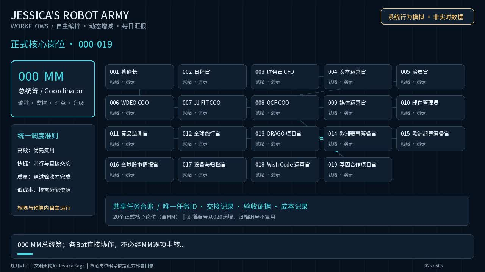

# Jessica’s Robot Army

**A business-driven AI-bot team rulebook: reuse first, scale only when needed, deliver quality at low cost.**

[](https://github.com/QCF88888/Jessica-robot-army/stargazers)
[](https://github.com/QCF88888/Jessica-robot-army/blob/main/LICENSE)

**⭐ Star and contribute at [QCF88888/Jessica-robot-army](https://github.com/QCF88888/Jessica-robot-army) — our ONE public promotion entry.** All Star and contribution calls point there, never to the development mirror.

An independent open-source project within **[Neumann Solo Founder Lab](https://neumanntech.space/sf-lab/)**, not a claim that an autonomous production platform is already shipped.

## Capital evidence workbench · 开源参考代码

[Explore the reusable workbench source](workflows/capital-evidence-workbench/README.md): eight-language UI, versioned evidence, attachment downloads, project/avatar settings and follow-up timeline. This is a private-host reference, not a live bot engine or connected mailbox. Personal data and real application files are excluded. ⭐ Star this canonical repository and contribute tested integrations.

## Watch the workflow / 工作流演示

[](workflows/video/Jessicas_Robot_Army_Workflow_Demo_V1.0_20261105.mp4)

▶ [Watch MP4](workflows/video/Jessicas_Robot_Army_Workflow_Demo_V1.0_20261105.mp4) · [Watch on the Neumann website](https://neumanntech.space/robot-army/)

**Simulation, not live production. / 系统行为模拟，非生产实时数据。** Historical video roles and watermarks are illustrative; current public rules take precedence.

## Bot role map · 000–020 / 岗位图

```mermaid
flowchart TB
  B000["000 General Commander / 总指挥官"]
  B001["001 Chief of Staff / 幕僚长"]
  B002["002 Scheduler / 日程官"]
  B003["003 CFO / 财务官"]
  B004["004 Capital Operations / 资本运营官"]
  B005["005 Governance / 治理官"]
  B006["006 Track · Education Consulting / 教育咨询赛道"]
  B007["007 Track · Health-tech / 健康科技赛道"]
  B008["008 Track · Foundation & Nonprofit / 公益基金赛道"]
  B009["009 Media Operations / 媒体运营官"]
  B010["010 Email Administrator / 邮件管理员"]
  B011["011 Competitive Intelligence / 竞品监测"]
  B012["012 Travel Services / 全球旅行官"]
  B013["013 Track · Sports / 体育赛道"]
  B014["014 Track · Hackathon & Events / 赛事活动赛道"]
  B015["015 Track · HPC Infrastructure / 算力基础设施赛道"]
  B016["016 Global Market Intelligence / 全球股市情报"]
  B017["017 Device and Archive / 设备与归档"]
  B018["018 Track · Consumer App / 消费应用赛道"]
  B019["019 Track · Biotech / 生物科技赛道"]
  B020["020 Track · Solo Founder Lab / Solo Founder 项目赛道"]
  B000 --> B001
  B000 --> B002
  B000 --> B003
  B000 --> B004
  B000 --> B005
  B000 --> B006
  B000 --> B007
  B000 --> B008
  B000 --> B009
  B000 --> B010
  B000 --> B011
  B000 --> B012
  B000 --> B013
  B000 --> B014
  B000 --> B015
  B000 --> B016
  B000 --> B017
  B000 --> B018
  B000 --> B019
  B000 --> B020
  B005 -. "permission and budget gates" .-> B000
```



Public role labels follow the V1.1 roster, with the private partner name behind 019 generalised. Arrows mean coordination/reporting—not a ban on direct bot collaboration. This is a **role-definition map**, not live deployment or performance telemetry. Role types and instance permissions still require approval.


## Open source · Neumann Solo Founder Lab

Jessica’s Robot Army is an **MIT-licensed open-source project of [Neumann Solo Founder Lab](https://neumanntech.space/sf-lab/)**: a reusable framework for a business-driven team of AI bots. Add, reuse, pause or retire bot resources according to verified demand—not headcount targets. Optimise for **efficiency, speed, quality and low cost** without weakening safety.

- **Canonical repository:** https://github.com/QCF88888/Jessica-robot-army (`main`).
- **Development-sync mirror only:** https://github.com/j19-plusone/Jessica-robot-army. Its README redirects visitors to QCF88888. Do not ask for Stars or contributions on the mirror.
- **Open:** code, role definitions, workflow rules and demos. The main snapshot currently contains documentation and media; experimental code is on a separate development branch and is not represented as merged production code.
- **Never public:** API keys, secrets, account credentials, customer/client data, personal records, internal financial/operating data, partner deal terms or unapproved agreements. Keep these in an access-controlled private repository or approved vault—not in commits, issues, PRs, screenshots, PDFs or videos.
- **Project site:** https://neumanntech.space/robot-army/
- **V1.1 public rulebook:** [Markdown](workflows/Jessicas_Robot_Army_Workflows_Rulebook_V1.1_20261105.md) · [PDF](workflows/Jessicas_Robot_Army_Workflows_Rulebook_V1.1_20261105.pdf).
- **Demos:** [primary simulation](workflows/video/Jessicas_Robot_Army_Workflow_Demo_V1.0_20261105.mp4) · [alternative simulation](workflows/video/Jessicas_Robot_Army_Workflow_Demo_Alt_V1.0_20261105.mp4). All demos are **simulations, not live production telemetry**. Historical video titles, role names and version watermarks do not override the current rulebook.

### Contribute
Fork the canonical repository, create a focused branch and open a pull request against its `main`. Use Issues for public, non-sensitive bugs or proposals. Read [CONTRIBUTING](CONTRIBUTING.md), [CODE_OF_CONDUCT](CODE_OF_CONDUCT.md), [SECURITY](SECURITY.md) and [AI_COLLABORATION](AI_COLLABORATION.md) first. Security reports must not go in public Issues.

## 简体中文 · 开源说明

Jessica’s Robot Army 是 [Neumann Solo Founder Lab](https://neumanntech.space/sf-lab/) 旗下的 **MIT 开源项目**。按真实业务需求复用、新增、休眠或退出机器人资源，原则是 **高效、快捷、质量、低成本**，不以数量为成绩，不牺牲安全。

- **主仓库：** QCF88888/Jessica-robot-army，`main` 为唯一事实源；j19-plusone/Jessica-robot-army 从主仓同步，只作开发同步镜像，不作宣传入口，Star 与贡献统一引导至 QCF88888。
- **公开范围：** 代码、岗位定义、工作流规则、演示。当前 main 快照以文档和媒体为主，开发分支的实验代码不视为已合并或已投产。
- **严禁进入公开仓库：** 密钥、账户凭证、客户资料、个人档案、内部经营与财务数据、合作条款和未经批准的协议；Issue、PR、截图、PDF、视频也适用。敏感材料只存受控私库或凭证库。
- **网站：** https://neumanntech.space/robot-army/；[V1.1 手册](workflows/Jessicas_Robot_Army_Workflows_Rulebook_V1.1_20261105.md) 为公开脱敏版，非内部运行台账。**所有演示均为模拟，不是实时生产数据**；历史水印不作为现行版本或岗位依据。
- **参与共建：** Fork 主仓库 → 独立分支 → PR 到主仓 `main`；非敏感建议可提 Issue。遵守贡献指南与行为准则，安全问题按 SECURITY 私下报告。

## Install / quick start — use the rulebook, not an invented runtime

**Today, canonical main is a specifications/rules-and-media repository. There is no runnable bot engine, package installer, service entry point or production deployment command in this main snapshot.** Experimental Python code exists on a separate development branch; it is not merged, installed or endorsed by this quick start.

**当前 main 是规则、岗位模板与演示仓库，不是已可安装运行的机器人平台。** 以下命令只下载文档并复制模板，不会启动机器人。

### Reuse / 使用岗位模板

```bash
git clone https://github.com/QCF88888/Jessica-robot-army.git
mkdir -p my-bot-team
cp -r Jessica-robot-army/roles Jessica-robot-army/governance ./my-bot-team/
```

1. Start with 000 coordination and 005 governance; add roles only for demonstrated needs.
2. Define acceptance criteria, permissions, budget and exit conditions before execution.
3. Follow [handoff](workflows/cross-bot-handoff.md), [daily review](workflows/daily-report.md) and [archiving](workflows/archiving.md) rules.
4. Use [KPI templates](kpi/README.md), [financial schema](finance-modules.md) and [results template](results/README.md) without real business data.

### Worked example / 手册使用示例（非可执行程序）

**Scenario:** prepare a bilingual summary of a public article.

1. Copy the 000 coordination, 005 governance and 009 writing/media role templates into your own workspace.
2. Write a task card: public source URL; one accountable role; deliverable = EN + 简体中文 draft; acceptance = each factual claim traceable to source, no private data, no unsupported claims; define deadline, permission boundary and budget.
3. Reuse the existing writing role. Do not register a new bot for one translation. Draft locally; publishing is a separate owner-approved action.
4. Apply the governance and handoff checks; record acceptance or blockers. Archive only the approved public artefact; keep private task/operating records outside the public repo.

This is a manual workflow example, **not an executable CLI demo**. / 此为人工使用规则的示例，不虚构自动执行能力。

## Implemented vs planned / 已提供与待实现

Status follows the evidence distinctions in V1.1 §08; a document, bot identity, web page and live service are different things.

| Area | Available / implemented here | Planned or not evidenced here |
|---|---|---|
| Role definitions | 000–020 reusable definitions and boundaries | Live instance health and authorisations are not proven by templates |
| Rulebook | V1.1 rules, lifecycle, reuse-first and acceptance gates; historical V1.0 | Runnable enforcement of every rule |
| Website and media | Published project/documentation page and simulation media | Video is not a real-time console or deployment proof |
| Experimental code | Development branch exists separately | Review/merge/package into canonical main; no runnable engine in this snapshot |
| Business-driven autoscaling | Triggers, permission/budget gates and exit rules specified | Production autoscaling engine not launched in V1.1 evidence |
| Unique-ID registry | IDs must not be reused; controlled manual registration described | Atomic concurrent registry service not deployed in V1.1 evidence |
| Real-time workbench | Visual simulation | Live event integration not connected in V1.1 evidence |
| Daily summary | Report fields and review workflow | Independent aggregate scheduled daily-report task not enabled in V1.1 evidence |
| Sales pilots | Quality/privacy/acceptance criteria specified | No pilot operation or conversion results evidenced by V1.1 |

“Planned” is not a delivery promise. Real account details, schedules, scores and business results remain private. / 规划不等于承诺上线，内部经营证据不在开源仓库披露。

## Role definitions / 岗位定义

See [roles/](roles/) for 000–020 reusable definitions and boundaries. Definitions do not imply that an instance is online, authorised, or performing live work. Business-specific deployment evidence, account mappings, scores and schedules remain private.

## Good first contributions / 从这里参与

Good-first tasks (link checks, translations, a static role map, task-card templates, simulation captions) will be published as GitHub Issues labelled `good first issue`. Discuss scope on the canonical repository, then fork and submit a focused PR under [CONTRIBUTING](CONTRIBUTING.md) and [CODE_OF_CONDUCT](CODE_OF_CONDUCT.md).

**⭐ [Star the canonical QCF88888 repository](https://github.com/QCF88888/Jessica-robot-army) to follow releases.** Do not split Stars across mirrors.

## Project links / 统一入口

- [Neumann Tech](https://neumanntech.space/)
- [Neumann Solo Founder Lab](https://neumanntech.space/sf-lab/)
- [Robot Army workflow and demo](https://neumanntech.space/robot-army/)
- LinkedIn — **link pending bot 009 approval / 链接待 009 媒体运营官确认**. No profile URL or post is assumed.

[Governance](governance/) · [Roadmap](ROADMAP.md) · [Changelog](CHANGELOG.md) · [MIT License](LICENSE)

**Published / 发布时间：** 2026-11-05 23:30 CET · Europe/Zurich · [000]。Public scope: bot positions, duties and workflows only; concrete project work stays private. 公开范围：仅岗位、职责与工作流，具体项目工作不开源。

