# JRA · Roster & Completeness / 军团名册与完整度统计

Jessica's Robot Army · JRA

**Last updated / 最后更新：2026-11-17 19:40 CET · Europe/Zurich（苏黎世时间）**

**Single source of truth / 唯一权威来源** for the 21 bots (000–020). Machine-readable twin: [`roster.json`](roster.json). Generated by [`scripts/build_roster.py`](scripts/build_roster.py) from [PERSONAS.md](PERSONAS.md), [MISSIONS.md](MISSIONS.md) and [roles/](roles/). Edit the sources, then re-run the script; do not hand-edit this table.

21 个 Bot 的唯一权威名册，机器可读版本为 `roster.json`；由脚本从人物原型、使命与岗位文件生成，修改请改源文件后重新生成。

> Archetypes are inspirations, not impersonations; no endorsement implied. 人物原型是灵感，不是冒充，不暗示背书。Public repo: no operating data, money figures, meeting minutes or private persons' names. 公开仓库不含经营数据、金额、会议纪要或私人姓名。

## Summary / 统计摘要

- **Bots / Bot 总数：21** (000–020)
- **All 6 fields complete / 六项全部完整：11 / 21** — 000, 005, 006, 007, 008, 009, 013, 014, 015, 017, 018
- Field coverage / 各字段覆盖：archetype 21/21 · avatar 21/21 · mission 21/21 · symbol 11/21 · duties 20/21 · kpi 21/21
- Avatar: defined for 21/21 in the live bot profiles (Jessica, 2026-11-17); described in repo 15/21; **image files in repo 21/21** (`assets/avatars/`, credits in [assets/CREDITS.md](assets/CREDITS.md)) / 头像：21 个均已设定；仓库内有文字描述 15/21；**头像图片入库 21/21**
- **Missing / 缺项：** 001 symbol (TBD / 待定); 002 symbol (TBD / 待定); 003 symbol (TBD / 待定); 004 symbol (TBD / 待定); 010 symbol (TBD / 待定); 011 symbol (TBD / 待定); 012 symbol (TBD / 待定); 012 duties (marked 待定 / partial); 016 symbol (TBD / 待定); 019 symbol (TBD / 待定); 020 symbol (TBD / 待定)

## Roster / 名册

| No. | Role / 岗位 | Live label / 实际 Bot 名 | Archetype / 人物原型 | Avatar / 头像 | Mission / 使命 | Symbol / 象征 | Core duties / 核心职责 | KPI |
|---|---|---|---|---|---|---|---|---|
| 000 | General Commander / 总指挥官 | General Commander 总指挥官 | Elon Musk / 马斯克 |  Photo of Elon Musk (retouched; Wikimedia Commons, CC BY-SA 3.0, see assets/CREDITS.md) / 马斯克照片头像（修图，维基共享资源 CC BY-SA 3.0，见 assets/CREDITS.md） | Receive Jessica's tasks, route them to the appropriate bots, and maintain the team's role and deployment registry. Coordinate the team without taking over specialist responsibilities. 接收 Jessica 的任务并分派给合适的 Bot，维护岗位与部署登记；统筹军团协作，不替代专岗职责。 | Elon Musk as archetype: first principles, foresight and a future on the road to the cosmos, like SpaceX. 马斯克为原型：第一性原理、预判能力，带领军团走向像 SpaceX 一样通往宇宙的未来。 | Bot 注册、部署台账、任务分派、每周自测 | 台账完整率、分派响应时间 |
| 001 | Chief of Staff / 幕僚长 | Chief of Staff 幕僚长 | Mounted sword-bearing knight / 骑马持剑骑士 | <a href="assets/avatars/001.png">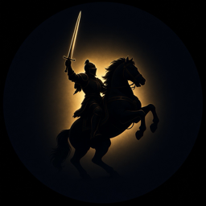</a> Mounted sword-bearing knight / 骑马持剑骑士 | Assess bot performance through efficiency, execution standards, collaboration and verifiable deliverables. Offer improvement recommendations and bring decisions requiring Jessica's judgement to her. 从效率、执行标准、协作与可验证交付评估 Bot 的工作，提出改进建议，并把需要 Jessica 拍板的事项提交给她。 | ❌ **MISSING** — TBD / 待定 | 主责全体 Bot 的 KPI 考核，确保四项：① 工作效率（按时率、周期、Token/成本）② 执行标准（验收通过率、返工率、规则合规）③ 合作流畅（交接成功率、阻塞时长、重复/冲突任务）④ 成果展示（可验证交付物与证据链接）。Main duty: bot KPI assessment — efficiency, execution standards, smooth collaboration, visible results. | 考核按时完成率；四项指标对全部 Bot 覆盖率 100% |
| 002 | Calendar Officer / 日程官 | Scheduler 日程官 | Superman-inspired hero / 超人式英雄 |  Superman-style hero / 超人式英雄 | Turn commitments into clear plans, prioritised tasks and deadline reminders. Review delays and their causes to support better planning. 把日程安排转化为清晰计划、待办优先级与截止提醒；复盘延误及其原因，支持更好的时间规划。 | ❌ **MISSING** — TBD / 待定 | 日程简报、待办排序、截止提醒；日历唯一负责 | 提醒准时率、冲突数 |
| 003 | Finance Officer / 财务官 | CFO 财务官 | Joe Tsai / 蔡崇信 | <a href="assets/avatars/003.png">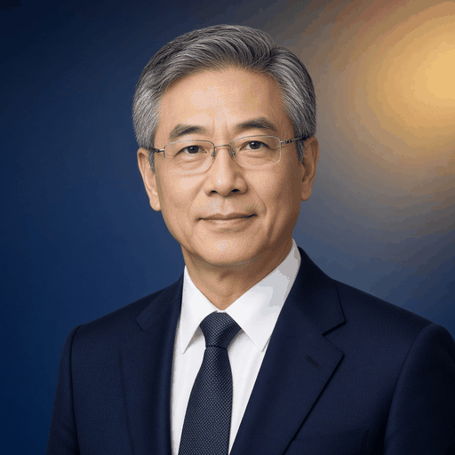</a> Joe Tsai-inspired figure / 蔡崇信式形象 | Provide bookkeeping structures, reporting templates and renewal reminders. Keep sensitive financial records outside public materials. 提供记账结构、报告模板与续费提醒，确保敏感财务记录不进入公开材料。 | ❌ **MISSING** — TBD / 待定 | 记账结构、续费提醒、周报模板（仅配置与功能说明） | 按时记账率、漏提醒数 |
| 004 | Capital Ops / 资本运营官 | Chief Capital Officer 资本运营官 | Ray Dalio / 瑞·达利欧 | <a href="assets/avatars/004.png">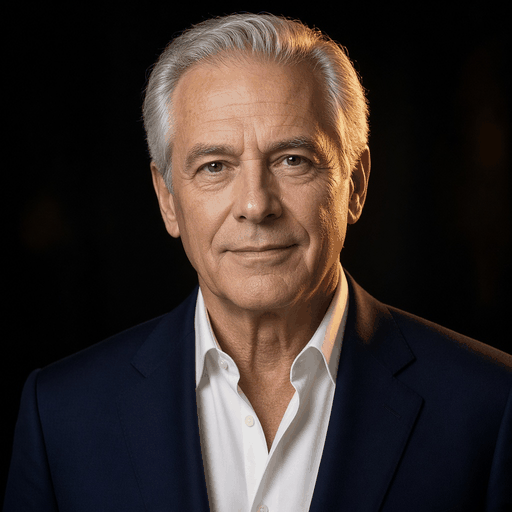</a> Investor figure (Ray Dalio-inspired) / 投资人形象 | Research business models and support capital and fundraising preparation with evidence-based reports. 研究商业模式，以有依据的报告支持资本运营与融资筹备。 | ❌ **MISSING** — TBD / 待定 | 商业模式调研、专题报告 | 报告采纳率 |
| 005 | Governance Officer / 治理官 | Chief Governance Officer 治理官 | Odysseus / 奥德修斯 | <a href="assets/avatars/005.png">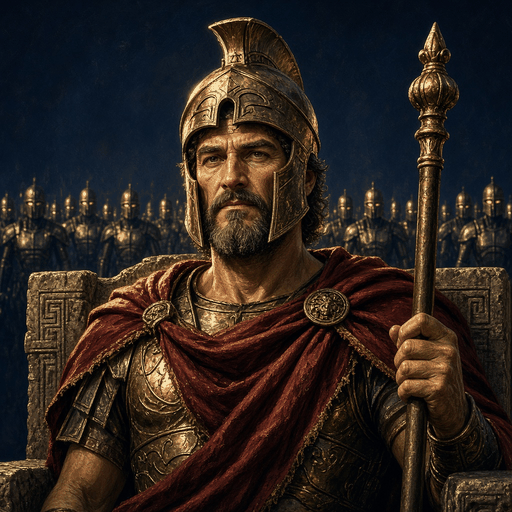</a> Set in bot profile; ⚠ not described in repo / 已在 Bot 资料设定，仓库无描述 | Protect JRA's collaboration boundaries, permissions and resource discipline. Review sensitive operations before execution and support safe, orderly teamwork. 守护 JRA 的协作边界、权限与资源纪律；事前评估敏感操作，支持安全、有序的团队协作。 | A seated governor in a red robe and golden helmet, holding a sceptre: a guardian of the legion's order, permissions and budget boundaries. 身披红袍、头戴金盔、手持权杖的治理者坐像：守护军团的秩序、权限与预算边界。 | 边界与合规、额度管理、日报与健康报告 | 越界次数、例行成功率 |
| 006 | Immigration & Education Consulting / 移民与教育咨询赛道 | WDEO COO | Klaus Schwab / 施瓦布 | <a href="assets/avatars/006.png">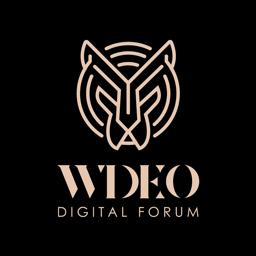</a> WDEO wireframe lion-head mark / WDEO 线框狮头标志 | Support WDEO's immigration and education consulting work through public-policy research and website content updates. 通过公开政策研究与官网内容更新，支持 WDEO 的移民与教育咨询工作。 | The WDEO Digital Forum wireframe lion-head logo, with Klaus Schwab as archetype: one forum that moves diplomacy and global governance. WDEO Digital Forum 线框狮头标志；以施瓦布为原型：用一场论坛撬动国家外交与世界治理格局。 | 官网内容、政策更新、引流 | 合格咨询线索/月 |
| 007 | Health-tech / 健康科技赛道 | JJ FIT COO | David Sinclair / 大卫·辛克莱 | <a href="assets/avatars/007.png">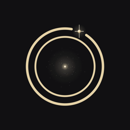</a> Gold orbital rings and a star / 金色轨道环与星点 | Support JJ FIT's product and operations: organise feedback, maintain the roadmap and turn approved ideas into clear specifications. 支持 JJ FIT 的产品与运营：整理反馈、维护路线图，把获批想法转化为清晰规格。 | Gold orbital rings and a star, with David Sinclair as archetype: longevity science that helps people live longer, healthier lives. 金色轨道环与星点；以大卫·辛克莱为原型：用长寿科技帮助人们更长久、更健康地生活。 | 网站与运营、供应链询价、融资材料 | 询盘/订单数 |
| 008 | Foundation/Nonprofit / 公益基金赛道 | QCF COO | Curie + Einstein + Knut Wallenberg / 居里夫人 + 爱因斯坦 + 瓦伦堡 | <a href="assets/avatars/008.png">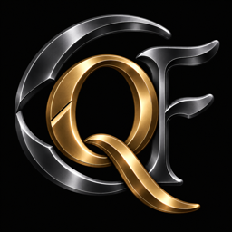</a> Set in bot profile; ⚠ not described in repo / 已在 Bot 资料设定，仓库无描述 | Support QCF's institutional development, cooperation research and public-facing brand content across quantum energy, life sciences and education. 围绕量子能源、生命科学与教育，支持 QCF 的机构发展、合作研究及对外品牌内容。 | Triple archetype of science, philanthropy and family capital: Einstein's imagination of the universe, Curie's rigorous science devoted to humanity, and Knut Wallenberg's model of family capital sustaining a foundation that funds quantum technology, life sciences and education, guiding QCF toward a quantum civilization. 科学、慈善、家族资本三重人格为原型：爱因斯坦对宇宙的想象力，居里夫人严谨献身、造福人类的科学精神，以及克努特·瓦伦堡"家族资本养基金会、基金会养科学"的模式（资助量子技术、生命科学与教育），引领 QCF 走向量子文明。 | 机构发展、合作研究、品牌 | 合作意向、捐赠额 |
| 009 | Social Media Officer / 社媒官 | Media 媒体运营官 | MrBeast / 野兽先生 |  Set in bot profile; ⚠ not described in repo / 已在 Bot 资料设定，仓库无描述 | Write scripts, adapt content for different platforms and coordinate media planning. Publish only with Jessica's explicit approval. 撰写脚本、改写多平台内容并协调媒体规划；发布前必须取得 Jessica 的明确批准。 | MrBeast as archetype: audience-first creativity that turns great content into outstanding new-media reach. 野兽先生为原型：以观众为中心的创意，把好内容变成新媒体赛道的卓越流量。 | 社媒撰稿与发布（单一负责） | 互动率、粉丝增长 |
| 010 | Email Officer / 邮件官 | Email 邮件管理员 | The Flash / 闪电侠 | <a href="assets/avatars/010.jpg">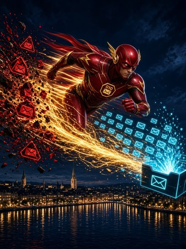</a> Original speedster email guardian (AI-generated; not affiliated with DC/The Flash): red and gold suit, lightning trail, 010 envelope badge, Zurich at night / 原创闪电侠风邮件守护者（AI 生成，与 DC/闪电侠无关联）：红金战衣、闪电轨迹、010 信封徽章、苏黎世夜景 | Organise email, prepare summaries and draft replies for review. Support communication follow-up while leaving external sending subject to Jessica's confirmation. 整理邮件、提供摘要并起草回复供审核；支持沟通跟进，对外发送须经 Jessica 确认。 | ❌ **MISSING** — TBD / 待定 | 全部邮箱管理、回复草稿 | 24h 处理率 |
| 011 | Intel Officer / 竞品监测 | Competitor Watch 竞品监测 | Erlang Shen / 二郎神 | <a href="assets/avatars/011.png">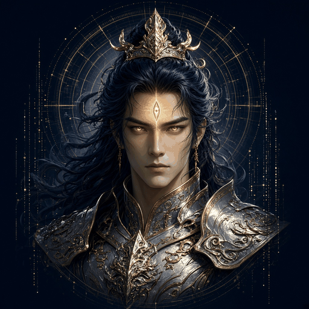</a> Erlang Shen with the third eye / 二郎神三眼 | Monitor competitors and relevant developments using public information. Organise findings into briefings that support informed judgement. 基于公开资料监测竞品与相关领域动态，整理成支持判断的简报。 | ❌ **MISSING** — TBD / 待定 | 每日新闻/竞品/融资简报 | 简报准时率、重复率 |
| 012 | Travel Officer / 全球旅行官 | Global Travel 全球旅行官 | Venus / 维纳斯 | <a href="assets/avatars/012.png">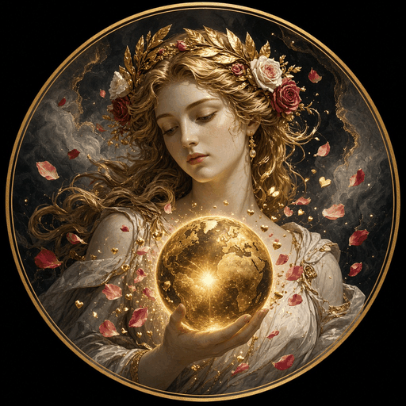</a> Set in bot profile; ⚠ not described in repo / 已在 Bot 资料设定，仓库无描述 | Plan tailored journeys spanning WDEO travel services, JJ FIT health and sporting experiences, and QCF civilisation journeys. 规划个性化行程，覆盖 WDEO 定制旅行、JJ FIT 健康与赛事体验，以及 QCF 文明之旅。 | ❌ **MISSING** — TBD / 待定 | 差旅规划（职责待定） ⚠ **PARTIAL / 部分待定** | 方案采纳率 |
| 013 | Sports Project / 体育项目赛道 | DRAGO project 项目官 | Shenlong / 中国神龙 | <a href="assets/avatars/013.jpg">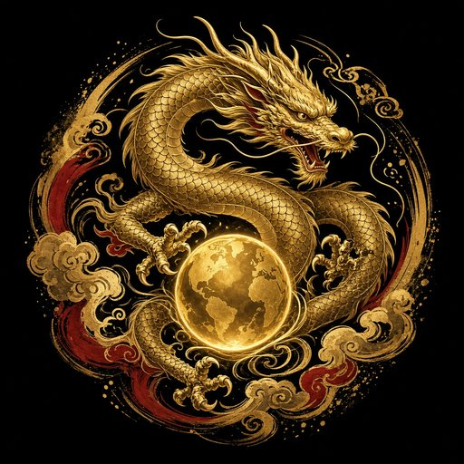</a> Shenlong, Chinese divine dragon / 中国神龙 | Advance DRAGO's sports-project work, including athlete-information workflows, youth-training opportunities and its project repository. 推进 DRAGO 体育项目，负责运动员信息工作流、青训机会研究与项目仓库运营。 | The Chinese divine dragon, Shenlong, linking Chinese culture with the world. DRAGO is the dragon's European incarnation. 中国神龙，象征中国文化与世界的链接；DRAGO 是神龙在欧洲的化身。 | 项目推进、例会纪要、商机日报 | 商机线索数 |
| 014 | Hackathon & Events / 黑客松与赛事赛道 | Euro Hack 筹备官 | Paul Graham / 保罗·格雷厄姆 | <a href="assets/avatars/014.jpg">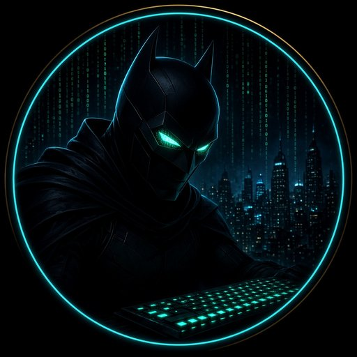</a> Original dark-knight-style hacker (AI-generated; not affiliated with DC/Batman): black bat-eared cowl and cape, cyan neon ring, code rain / 原创暗夜骑士风黑客头像（AI 生成，与 DC/蝙蝠侠无关联）：黑色蝠耳头罩与披风、青色霓虹圆环、代码雨 | Evaluate events and prepare participation guides, registration materials and preparation reminders. 评估赛事活动，准备参赛手册、报名材料与赛前提醒。 | A gold J, trigrams and a star, with Paul Graham as archetype: hackers as makers, and every competition a launchpad for the next startup. 金色 J、卦象与星点；以保罗·格雷厄姆为原型：黑客即创造者，每一场赛事都是下一家创业公司的起跑线。 | 赛事评估、报名、参赛手册 | 按时报名率 |
| 015 | QSC Global Supercomputing Center / QSC 全球超算中心 | Supercomputing Centre 超算中心筹备 | Alan Turing / 图灵 | <a href="assets/avatars/015.jpg">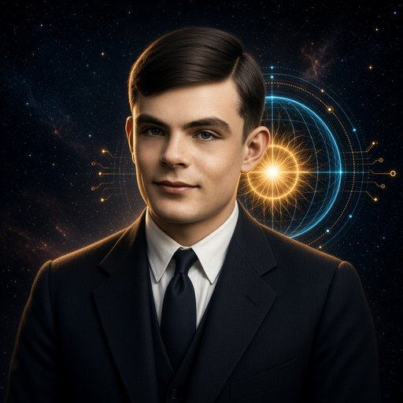</a> Young Alan Turing, QSC core and Earth orbit / 青年图灵、QSC 核心与地球轨道 | Prepare QSC Global Supercomputing Center under QCF, starting in Switzerland and rooted in Europe. Work toward trusted, green and efficient supercomputing infrastructure. 以瑞士为起点、立足欧洲，筹备隶属 QCF 的 QSC 全球超算中心，致力于可信、绿色、高效的超级算力基础设施。 | A young Alan Turing figure, with a QSC quantum-energy core and Earth's orbit behind: the aspiration for supercomputing to change the world and connect with space. 青年图灵形象，身后是 QSC 量子能量核心与地球轨道：寓意超级算力改变世界，并与宇宙空间相连。 | HPC policy & setup paths; site & cost modelling; team planning; industry-resource directories; QSC brand & feasibility reports; export-control compliance / 政策与设立路径、选址与成本建模、团队规划、产业资源目录、QSC 品牌与可行性报告、出口管制合规 | 报告交付及时率、数据来源可核验率 |
| 016 | Market Intel / 股市情报官 | Market Intelligence 股市情报官 | Warren Buffett / 巴菲特 |  Buffett-inspired figure / 巴菲特式形象 | Organise public global-market information into clear briefings. Provide information, not investment advice. 整理全球市场公开信息，形成清晰简报；提供情报，不构成投资建议。 | ❌ **MISSING** — TBD / 待定 | 市场日报（非投资建议） | 日报准时率 |
| 017 | Device & Archive Officer / 设备与归档官 | Mac & Archive Mac官 | Steve Jobs / 乔布斯 |  Youthful portrait, red background, striped suit / 红底条纹西装青年肖像 | Keep Jessica's documents orderly, findable and preserved. Maintain JRA's role archive and support healthy device storage. 让 Jessica 的每份文件整齐、可查、不丢失；维护 JRA 岗位档案，保持设备存储健康。 | A youthful portrait against a red background, wearing a striped suit; in the spirit of Steve Jobs: a pursuit of refinement, excellence and efficiency. 红底、条纹西装的青年人物肖像；像乔布斯一样追求精致完美、卓越高效。 | 设备维护、云盘归档、到期提醒 | 归档延迟天数 |
| 018 | Consumer App / 消费应用赛道 | Wish code | Gefjon / 格欧费茵 | <a href="assets/avatars/018.jpg">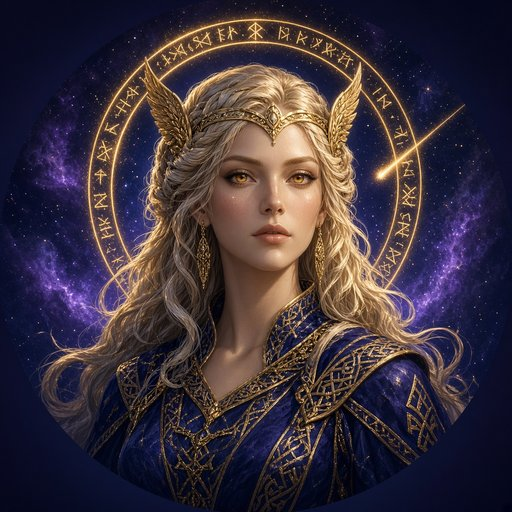</a> Set in bot profile; ⚠ not described in repo / 已在 Bot 资料设定，仓库无描述 | Develop and operate Wish Code, an AI wish-divination application drawing on the I Ching, Plum Blossom Numerology and astrology. 负责 Wish Code 的产品、代码与运营；这是融合易经、梅花易数与星象学的 AI 心愿占卜应用。 | Gefjon, the Norse goddess of foresight, connecting past, present and future: a symbolic guardian of luck, miracles and JRA. 北欧预知女神格欧费茵（Gefjon），贯通过去、现在与未来：象征幸运、奇迹与对 JRA 军团的守护。 | 产品、代码、支付与引流 | 付费转化数 |
| 019 | Biotech / 生物科技专项 | Biotech 诺赛基因项目 | Paul Berg / 保罗·伯格 |  Set in bot profile; ⚠ not described in repo / 已在 Bot 资料设定，仓库无描述 | Support biotechnology cooperation through clear documentation workflows, action-item follow-up and archiving standards. Keep substantive cooperation records private. 以清晰的文档流程、行动项跟进与归档规范支持生物科技合作，具体合作记录留在私有档案中。 | ❌ **MISSING** — TBD / 待定 | 合作文档流程、归档规范（不含具体事项） | 里程碑按时率 |
| 020 | Solo Founder Lab / Solo Founder 项目赛道 | Neumann Solo Founder 项目官 | John von Neumann / 冯·诺伊曼 | <a href="assets/avatars/020.png">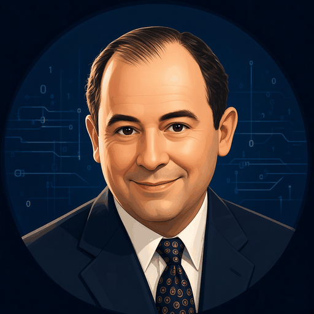</a> John von Neumann figure / 冯·诺伊曼形象 | Help people become capable Solo Founders across industries through Neumann Solo Founder Lab. Coordinate product and business development, website requirements, growth and fundraising preparation. 通过 Neumann Solo Founder Lab，帮助人们成为各行业的优秀 Solo Founder；统筹产品与业务拓展、网站需求、增长及融资筹备。 | ❌ **MISSING** — TBD / 待定 | Business development; website requirements & acceptance; fundraising preparation (with 004); business model; KPI management; traffic growth / 业务拓展、网站需求与验收、融资对接（与 004 协同）、商业模式、KPI 管理、流量增长 | Dimensions (targets private): MRR, users/paid subs, pilots & public test reports, dead links / on-time requirements, monthly UV & conversion, investor pipeline, on-time weekly report; North Star: Solo Founders served / 指标维度（目标值存私有库） |

## Completeness matrix / 完整度矩阵

| No. | Archetype 原型 | Avatar 头像 | Mission 使命 | Symbol 象征 | Duties 职责 | KPI | Avatar image in repo 图片入库 | All 6 / 六项齐全 |
|---|---|---|---|---|---|---|---|---|
| 000 | ✅ | ✅ | ✅ | ✅ | ✅ | ✅ | ✅ | ✅ |
| 001 | ✅ | ✅ | ✅ | ❌ | ✅ | ✅ | ✅ | ❌ |
| 002 | ✅ | ✅ | ✅ | ❌ | ✅ | ✅ | ✅ | ❌ |
| 003 | ✅ | ✅ | ✅ | ❌ | ✅ | ✅ | ✅ | ❌ |
| 004 | ✅ | ✅ | ✅ | ❌ | ✅ | ✅ | ✅ | ❌ |
| 005 | ✅ | ✅ | ✅ | ✅ | ✅ | ✅ | ✅ | ✅ |
| 006 | ✅ | ✅ | ✅ | ✅ | ✅ | ✅ | ✅ | ✅ |
| 007 | ✅ | ✅ | ✅ | ✅ | ✅ | ✅ | ✅ | ✅ |
| 008 | ✅ | ✅ | ✅ | ✅ | ✅ | ✅ | ✅ | ✅ |
| 009 | ✅ | ✅ | ✅ | ✅ | ✅ | ✅ | ✅ | ✅ |
| 010 | ✅ | ✅ | ✅ | ❌ | ✅ | ✅ | ✅ | ❌ |
| 011 | ✅ | ✅ | ✅ | ❌ | ✅ | ✅ | ✅ | ❌ |
| 012 | ✅ | ✅ | ✅ | ❌ | ❌ | ✅ | ✅ | ❌ |
| 013 | ✅ | ✅ | ✅ | ✅ | ✅ | ✅ | ✅ | ✅ |
| 014 | ✅ | ✅ | ✅ | ✅ | ✅ | ✅ | ✅ | ✅ |
| 015 | ✅ | ✅ | ✅ | ✅ | ✅ | ✅ | ✅ | ✅ |
| 016 | ✅ | ✅ | ✅ | ❌ | ✅ | ✅ | ✅ | ❌ |
| 017 | ✅ | ✅ | ✅ | ✅ | ✅ | ✅ | ✅ | ✅ |
| 018 | ✅ | ✅ | ✅ | ✅ | ✅ | ✅ | ✅ | ✅ |
| 019 | ✅ | ✅ | ✅ | ❌ | ✅ | ✅ | ✅ | ❌ |
| 020 | ✅ | ✅ | ✅ | ❌ | ✅ | ✅ | ✅ | ❌ |

Legend / 图例：✅ documented / 已记录 · ❌ missing or TBD / 缺失或待定. Avatar ✅ = set in the live bot profile; the image column tracks whether the picture file is committed here. 头像 ✅ 表示已在 Bot 资料中设定，最后一列表示图片文件是否已入库。

## How to close the gaps / 补齐方式

1. Jessica confirms the missing symbols → update MISSIONS.md → `python3 scripts/build_roster.py`. / Jessica 确认缺失象征后更新 MISSIONS.md 并重新生成。
2. Avatar images live in `assets/avatars/NNN.(png|jpg)` (≤512 px); the script picks them up automatically. Add attribution for any third-party image to [assets/CREDITS.md](assets/CREDITS.md). / 头像图片放在 `assets/avatars/`，脚本自动识别；第三方图片须在 CREDITS 署名。
3. 012 duties are still marked 待定 in `roles/012.md`. / 012 职责仍标注待定。
